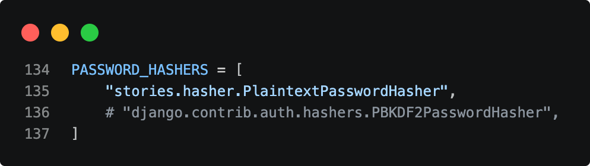
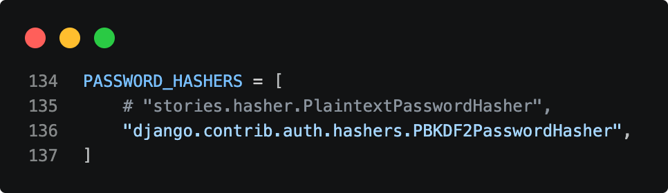
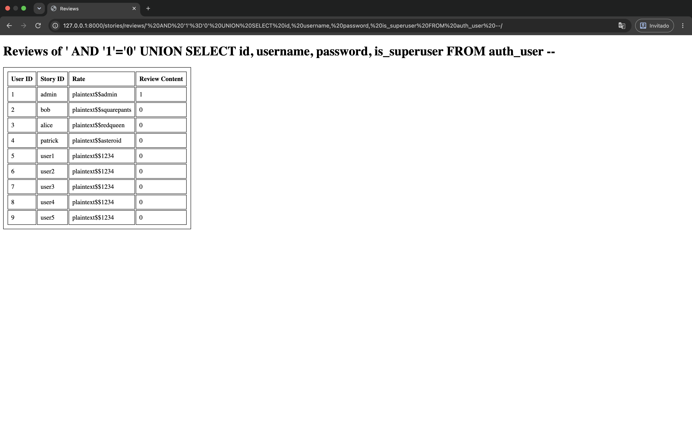
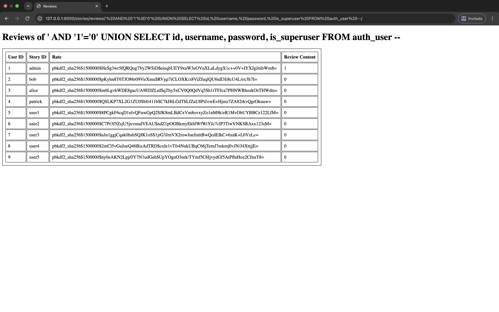

# cybersecuritybase.mooc.fi2026

## Link to the repository

LINK: https://github.com/LaurenYS/cybersecuritybase.mooc.fi2026

## Instructions to run the project

1. Clone the repository with the command:

    ```bash
    git clone https://github.com/LaurenYS/cybersecuritybase.mooc.fi2026.git
    ```

2. Navigate to root directory of the project (the directory that contains this README file).

    It is assumed that you have Python 3.8 or higher installed in your system. If not, please install it first.

3. Use the command `make setup` to create a virtual environment, install the dependencies in `requirements.txt`, and populate the database with sample data.

    *I don't know if running on Windows the `make` command will work, so if it doesn't work, just open the `Makefile` and run the commands in the `setup` target manually.*

4. Use the command `make run` to start the Django development server *(or activate the virtual environment and run `python manage.py runserver`)*.

## What is this project about?

It is a simple Django web application that allows users to create stories and rate them. The reviews should be annonymous, so that only the user that wrote the review can see the rate they gave to a story. The average rate of a story is shown to all logged-in users, but the individual rates are hidden.

All the functionalities described above are mean to be used only by logged-in users.

## Flaws

I used the [2021 OWASP Top 10 Web Application Security Risks](https://top10.owasp.org/2021/) as my reference.

---

### FLAW 1:&nbsp;&nbsp;`A03 Injection`

#### A. Exact source link pinpointing flaw 1

- [stories/views.py](https://github.com/LaurenYS/cybersecuritybase.mooc.fi2026/blob/main/stories/views.py#LXXX)

#### B. Description of flaw 1

It's an SQL injection flaw.

When fetching the HTTP request `GET /stories/reviews/<username>` for listing all the reviews an user has written I didn't use Django's ORM to fetch the reviews.

Instead, I wrote manually a raw SQL query using user input directly. This allows an attacker to manipulate the SQL query by injecting malicious SQL code through the 'username' parameter.

**How to exploit it?** There are probably many different queries that can be injected, but the one I have found it's very dangerous because it allows to get all the users information (including their passwords or whether they are superusers or not).

```SQL
' AND '1'='0' UNION SELECT id, username, password, is_superuser FROM auth_user --
```

#### C. How to fix flaw 1

The fix for this flaw is to use Django's ORM instead of raw SQL queries. This can be done by replacing the raw SQL query with a Django query that uses the `username` parameter in a safe way.

#TODO: add screenshot of the code and the website before and after the fix.

---

### FLAW 2:&nbsp;&nbsp;`A01 Broken Access Control`

#### A. Exact source link pinpointing flaw 2

- [stories/views.py](https://github.com/LaurenYS/cybersecuritybase.mooc.fi2026/blob/main/stories/views.py#LXXX)

#### B. Description of flaw 2

Even after fixing the SQL injection flaw (see [flaw 1](#flaw-1a03-injection)), an attacker can still retrieve the reviews of any user in the system, when all reviews should be annonymous and only the user that rated the review should be able to see the rate they gave to a story.

#### C. How to fix flaw 2

<!-- The easiest way to fix this flaw is to check if the user who is already logged in is the same user whose reviews are being requested. If they are not the same user, then the request will return a empty list of reviews.

Instead of raising a 403 Forbidden error, I decided to return an empty list of reviews, because if I did that, an attacker could use the 403 error to check if a user exists in the system or not. -->

The easiest way to fix this flaw is to check whether the logged-in user is the same user whose reviews are being requested. If they aren't the same user, the request returns an empty list of reviews.

Instead of raising a 403 Forbidden error, I returned an empty list of reviews because a 403 error would let an attacker check whether a user exists in the system.

***A brief comment:** if we only fixed this flaw (and not the SQL injection one), a SQL injection would be more difficult to exploit, but still possible if an attacker creates a new user with a username the same as the injection query (see [flaw 1](#flaw-1-a03-injection)).*

---

### FLAW 3: A07 Identification and Authentication Failures

#### A. Exact source link pinpointing flaw 3

#### B. Description of flaw 3

The system allows users to have weak passwords, which makes it easier for attackers to guess or brute-force them.

#### C. How to fix flaw 3

In a default Django project, the system already has a password validation system that checks for weak passwords. However, in this project, I disabled it in order to make it easier to test the system.

So the fix for this flaw is to enable again the password validation system in Django by uncommenting the lines XXX-XXX in `settings.py`.

Note that as it is specified in the [Django documentation](https://docs.djangoproject.com/en/4.2/topics/auth/passwords/#password-validation),

#TODO: add screenshot of the code and the website before and after the fix.

---

### FLAW 4: A02 Cryptographic Failures

#### A. Exact source link pinpointing flaw 4

- [PlaintextPasswordHasher (stories/hasher.py)](https://github.com/LaurenYS/cybersecuritybase.mooc.fi2026/blob/main/stories/hasher.py#L4)
- [config/settings.py](https://github.com/LaurenYS/cybersecuritybase.mooc.fi2026/blob/main/settings.py#LXXX)

#### B. Description of flaw 4

This flaw is related to the use of a plaintext password hasher instead of a secure password hasher.

This flaw is specially important when, combined with an SQL injection flaw (see [FLAW 1](#flaw-1-a03-injection)), it allows an attacker to retrieve the password of any user in the system, including the admin user.

#### C. How to fix flaw 4

Django alredy provides a secure password hasher by default, so the fix is to comment the [line 135](https://github.com/LaurenYS/cybersecuritybase.mooc.fi2026/blob/main/settings.py#L135) in `settings.py` and uncomment the [line 136](https://github.com/LaurenYS/cybersecuritybase.mooc.fi2026/blob/main/settings.py#L136).

**Code before the fix:**



**Code after the fix:**



**NOTE:** *For seeing the effects of this fix, you need to delete the database and populate it again, because the passwords of the users are already stored in plaintext in the database. So changing the password hasher will not change the passwords that are already stored in the database. Furthermore, the users whose passwords are already stored in plaintext won't be able to log in anymore, because the system will try to hash their passwords and compare them with the hashed passwords stored in the database, which will not match.*

Here I'll show two screenshots of the code with the SQL injection fix not yet applied (see [flaw 1](#flaw-1a03-injection)) before and after the fix of the password hasher flaw.

After fixing the password hasher flaw, even if the attacker is able to retrieve the password of the admin user, it will be hashed and not in plaintext, so the attacker won't be able to use it.

**Website before the fix of the password hasher flaw (the attacker is able to retrieve the password of the admin user in plaintext):**



**Website after the fix of the password hasher flaw (the attacker is able to retrieve the password of the admin user, but it is hashed and not in plaintext):**



---

### FLAW 5

#### A. Exact source link pinpointing flaw 5

#### B. Description of flaw 5

#### C. How to fix flaw 5
